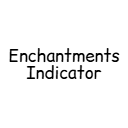
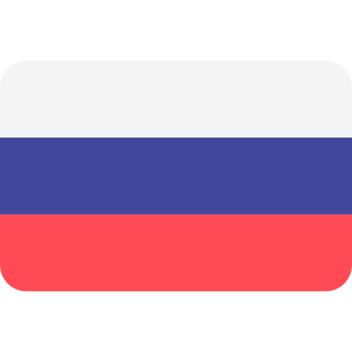
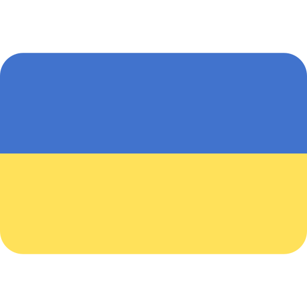
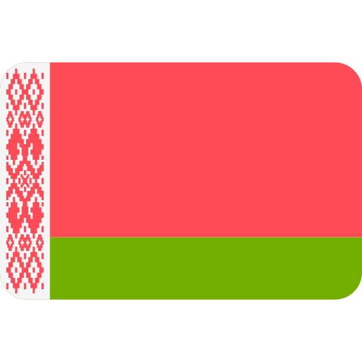
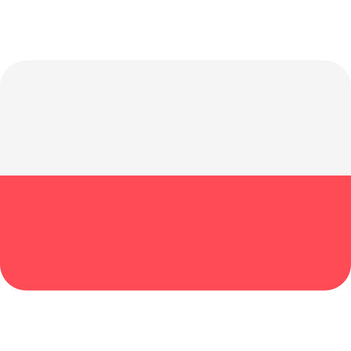

  

  

## About
This mod replaces the **standard, flat glow effect** on enchanted armor with **fully customizable visual effects**. You can freely change the *color of the armor textures* or the *glow itself*, making it easy to instantly identify specific enchantments on other players' gear.

The mod supports **multi-color gradients** for the glow effect. These visual changes extend beyond the character model: the recolored textures and tinted glows also appear on items within your inventory, making it easier than ever to sort and distinguish between pieces of equipment. The mod is fully localized and supports five languages: **English, Russian, Ukrainian, Belarusian, and Polish**.

> **Note:** As this mod is purely visual and operates entirely on the `client-side`, it **does not need to be installed on the server** — it functions correctly in any gameplay environment.

## Preview

## Credits
Created by **harimasa**. Special thanks to:

- GUI inspired by [NoboKik](https://github.com/NoboKik) using ImGui.
- [imgui-java](https://github.com/SpaiR/imgui-java) for providing ImGui bindings for Java.
- [Magnific](https://www.magnific.com) for the flag icons.
- Art is inspired by [ImPiglet](https://modrinth.com/user/ImPiglet).
- Moral supps [drimbik](https://github.com/drimbik).
- [Github](https://github.com/harimasa/perfect-icons-trust-me) behind the host of beautiful icons

## Features
**Enchantments Indicator** - is a highly customizable visual utility mod
that allows you to instantly recognize enchantments on player armor and items without opening inventories.

## Dependencies

| Mod / Runtime | Version     | Required |
|---------------|-------------|:--------:|
| Fabric API    | any (`*`)   |    ✅     |
| Fabric Loader | `>= 0.20.1` |    ✅     |
| Minecraft     | `1.21.11`   |    ✅     |
| Java          | `>= 21`     |    ✅     |
| Mod Menu      | `>=17.0.1`  |    ❌     |

## Supported Versions

| Version | Status |
| :--- | :---: |
| `1.21.11` | ✅ |
| `26.1` | ❌ |
| `26.2` | ❌ |
| `26.3` | ❌ |

## Language

-  <b>English</b>
-  <b>Russian</b> (Русский)
-  <b>Ukrainian</b> (Українська)
-  <b>Belarusian</b> (Беларуская)
-  <b>Polish</b> (Polski)

## Roadmap
- ~~_best gui_~~
- _~~Inventory visuals~~_
- ~~_Partitioning into classes_~~
- _~~Menu localization~~_
- _~~Config~~_
- _~~Logo~~_
- _~~Custom keybind~~_
- _~~Language selection dropdown~~_
- CI/CD
- liquid glass
- _~~modmenu open menu~~_

## License
The mod is licensed under the MIT license. Link to [MIT License](https://github.com/harimasa/enchantments-indicator/blob/master/LICENSE)